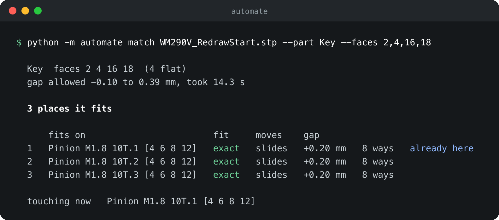

# automate

you pick a few faces on one part of a CAD assembly. this tool finds every other place in the assembly where those faces would fit, tells you which part each place is on, and says if its an exact fit or a sliding one.

**try it:** https://autometa-app.vercel.app. open examples, pick the chuck key, press find mates.


on the lathe from the assignment, the four flat sides of the chuck key tip find all three pinion sockets on the chuck. each one is an exact fit with 0.2 mm of gap, and the socket the key already sits in is marked.

## how it works


a STEP file stores the exact shape of every face, so the tool reads each one as a plane, cylinder, cone or ball with its real size and direction. no meshes, no guessing.

then it only looks at faces that could actually touch the ones you picked. a shaft only pairs with a hole of about the same size, and a flat face only pairs with a flat face pointing back at it. this is also what stops a key from matching another key.

the picked faces are matched as a group, not one by one. the angles and distances between them have to show up again on the target. one flat face alone would match thousands of flat faces in a lathe, but four flats at right angles, 7.8 mm apart, match almost nothing except the real sockets.

for every group that passes, it works out the one move that puts the part there, then checks three things: the gaps are small enough, the faces really overlap (not just line up 200 mm apart), and the two solid parts dont run into each other. that last check is what throws out the vice jaw flipped upside down into the T-slot.

a square key drops into a square socket 8 different ways. those count as one match.

## exact or sliding

you cant tell from the gap. the lathe key has 0.2 mm on every side but the assignment calls it exact. the real bench vice jaw has 0 gap but its the sliding example.

so it looks at what the part can still do once its in. if its held, or its only free direction runs into a stop (like the bottom of the socket), thats exact. if it can keep sliding or spinning with nothing to stop it, thats sliding. a negative gap means its too tight.

## results

| case | file | found |
|---|---|---|
| chuck key | lathe | 3 pinion sockets, exact, 0.2 mm gap |
| chuck key | grabcad sim model, key turned 11 deg | same 3, exact |
| key, 4 sockets and 3 decoy pockets | test part | 4 of 4, decoys ignored |
| belt in the big pulley | lathe | the groove, exact |
| belt on the small pulley | lathe | no fit, the belt V is 38 deg and the groove 34 |
| taper bushes | lathe | each finds its own pulley |
| pulley bore on the motor shaft | lathe | no fit. the model puts a 20 mm bore on a 24 mm shaft |
| bench vice jaw | real CATIA vice | the base rails, sliding |
| keyed shaft | test part | shaft keyway exact, both hub keyways sliding |
| countersunk screw | grabcad motor mount | all 8 holes, exact |


all 20 runs, with full json, are in [results/](results/README.md).

## why this way

it finds every place, not just the best one, which is what the assignment asks for. the sizes come straight from the file, so a 0.2 mm gap or a 4 degree difference in a belt groove shows up. every match lists which face landed on which and the gap on each, so you can check it by hand in any CAD program. and it needs no training data, so it works on any STEP file at any angle.

point cloud methods like ICP throw away the exact sizes and return one answer. learned models like AutoMate and JoinABLe need training data and predict one joint, not a full list with gaps.

## what it doesnt do yet

a lone hole fits any shaft its size, so those matches are marked low confidence. a lone flat face, or flats that all point the same way, fit almost everything, so the tool doesnt search those and asks you to pick another face instead. gear teeth, spirals and cams are skipped because they arent planes, cylinders, cones or balls. the collision check needs real solids, and the lathe motor is only surfaces.

with another week i would solve "can it be pushed in" properly instead of looking for stop faces, suggest the faces to pick so its one click, spot bolt circles and other patterns, and test against the labelled joints in the Fusion 360 Gallery.

## run it

the lathe from the assignment (`WM290V_RedrawStart.stp`) is in the repo, so this works right after cloning.

```sh
python3.13 -m venv .venv
.venv/bin/pip install cadquery-ocp-novtk numpy pytest
```

from the command line:

```sh
.venv/bin/python -m automate match WM290V_RedrawStart.stp --part Key --faces 2,4,16,18
```



add `--out key.json` for the full detail. `python -m automate faces <file> "<part>"` lists the faces of a part.

or open the viewer:

```sh
.venv/bin/python -m automate serve WM290V_RedrawStart.stp fixtures/*.step
# open http://127.0.0.1:8765
```

click faces on a part and press find mates. green is exact, blue is sliding. every tolerance is a slider, and the search runs again when you let go.

tests:

```sh
scripts/fetch_external.sh        # downloads the bench vice
.venv/bin/python -m pytest -q    # 18 tests
```

the live site runs the backend on azure (`scripts/deploy_azure.sh`) and the page on vercel, which passes `/api` on to azure.
