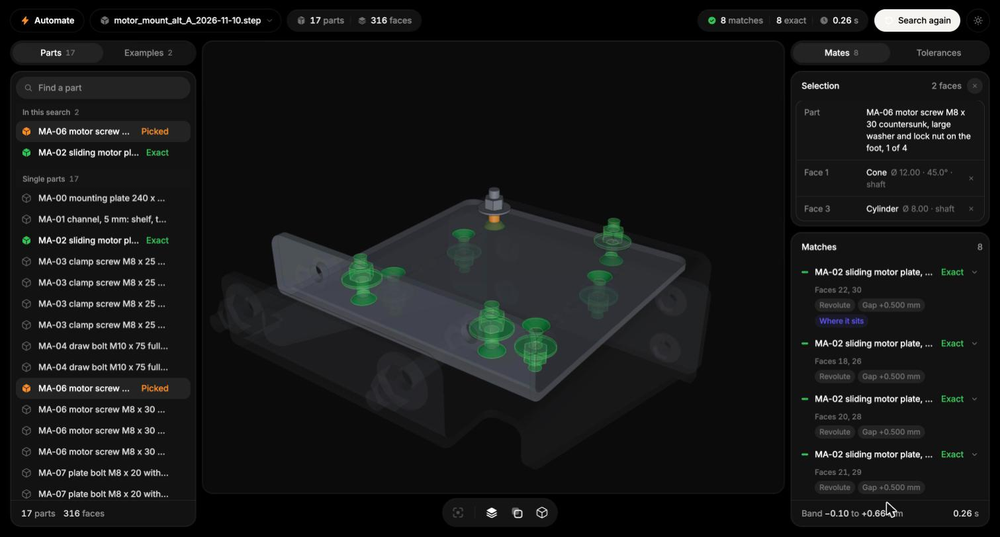

# automate

give it a STEP assembly and a few faces picked on one part. it finds every place in the assembly
where that face group fits, says which part each match is on, and whether it is an exact fit or a
sliding one.


the write up (what it compares and why, what breaks, next steps) is in [WRITEUP.md](WRITEUP.md).
results for every test case are in [results/](results/README.md).

## setup

tested with python 3.13 on macOS (pyproject asks for 3.11+). the only real dependency is OpenCascade through
the `cadquery-ocp` wheels, no conda needed.

```sh
python3.13 -m venv .venv
.venv/bin/pip install cadquery-ocp-novtk numpy pytest
```

## find mates from the command line

```sh
# faces 2,4,16,18 of the part called Key (the square tip of the chuck key)
.venv/bin/python -m automate match ../assignment/WM290V_RedrawStart.stp --part Key --faces 2,4,16,18 --out key.json
```

```
Key faces [2, 4, 16, 18] -> 3 match(es) in 18.2s
  TOS Svitavy 125.1/Assem1.1/Pinion M1.8 10T.1 (in place): faces {'TOS Svitavy 125.1/Assem1.1/Pinion M1.8 10T.1': [4, 6, 8, 12]} | fit=exact motion=prismatic dof=1 gaps=[+0.200, +0.200, +0.200, +0.200] x8 sym conf=high
  TOS Svitavy 125.1/Assem1.1/Pinion M1.8 10T.2: faces {'TOS Svitavy 125.1/Assem1.1/Pinion M1.8 10T.2': [4, 6, 8, 12]} | fit=exact motion=prismatic dof=1 gaps=[+0.200, +0.200, +0.200, +0.200] x8 sym conf=high
  TOS Svitavy 125.1/Assem1.1/Pinion M1.8 10T.3: faces {'TOS Svitavy 125.1/Assem1.1/Pinion M1.8 10T.3': [4, 6, 8, 12]} | fit=exact motion=prismatic dof=1 gaps=[+0.200, +0.200, +0.200, +0.200] x8 sym conf=high
  touching now: TOS Svitavy 125.1/Assem1.1/Pinion M1.8 10T.1 (in place): ...
```

a run took 15 to 22 s here. reading the 22 MB file is about 3 to 5 s and describing all 8257 faces about
9 s, the search itself is the rest. in the viewer the assembly stays loaded, so a repeat search took
0.1 s (belt) to about 2 s (key).

- face ids are 1-based, in OpenCascade `TopExp.MapShapes` order on the part.
  `python -m automate faces <step> "<part>"` lists the faces of a part with type, size and normal.
- the assignment gives the input as a separate STEP of the single part. pass it with `--part-step key.step`
  and the face ids refer to that file. the tool finds the same part inside the assembly by its face list
  (checked with the key written out on its own: same 3 pinions). if no part has the same face list it
  stops with an error.
- `--instance` picks one copy when a part is used more than once.
- every threshold is a flag: `--gap-rel --gap-max --gap-min --interference --exact --angle --overlap --collide`.

### what comes back

`matches.json` has one entry per place the group fits:

| field | meaning |
|---|---|
| `instance`, `part`, `target_faces` | where it fits, as face ids per part instance |
| `selected_to_target` | which selected face lands on which target face, the gap (mm, + is clearance) and how much of it overlaps |
| `fit` | `exact`, `sliding` or `interference` (rule in the write up) |
| `motion`, `dof`, `free_directions` | what the selected part can still do once mated: fixed, prismatic, revolute, cylindrical, planar, spherical |
| `stops` | faces that close off a free direction (the bottom of a socket) |
| `symmetry` | how many ways the group drops into the same spot (a square key: 8) |
| `in_place` | this is where the part already sits in the assembly |
| `confidence` | `low` when the selection alone leaves 2+ dof (a single bore), so lots of things will fit |
| `world` | 4x4 pose the selected part would have at this match |

`in_place_contacts` lists what the selection touches right now, across parts, including partial contact.
`rejected` lists face matches thrown out because the solids would run into each other.

## viewer

```sh
.venv/bin/python -m automate serve ../assignment/WM290V_RedrawStart.stp fixtures/chuck_4slot.step ...
# open http://127.0.0.1:8765
```

give it one or more STEP files, switch between them from the file menu in the top bar. each opens the
first time it is picked (the lathe took about 7 s), then stays loaded. the first search in a file also
describes its faces (about 9 s on the lathe), later ones are quick.

- click faces on one part to select them, click again to drop one. the inspector lists each face with its
  type and size (plane area, cylinder or cone diameter, cone angle, shaft or hole).
- **find mates** paints every match on the target faces (green exact, blue sliding, red interference),
  x-rays the rest and drops a see-through copy of your part at each match. the camera flies there.
- click a match card to fly to it and see the gap on each face pair and the face that stops the slide.
- every tolerance is a slider. let go of one and the search runs again, so you can watch a fit appear or
  vanish (drag clearance under 2.6% and the chuck key stops fitting its 0.2 mm sockets).
- the left side lists every part instance (search, hide, click to frame), with whatever the last search touched
  pinned on top, and a tab of saved example selections.
- light and dark, the moon at the top right. keys: `f` frame, `x` x-ray, `g` ghosts, `e` feature lines,
  `[` and `]` fold the side panels away (also the round buttons in the top bar) so the model gets the whole window.



the page is react + three.js (react three fiber) in a floating tool style: pills, ring cards, fill sliders,
inter, small accent colours. it lives in `web/` and the built copy in `web/dist` is committed, so the
python server is all you need. to work on it:

```sh
cd web && pnpm install
AUTOMATE_API=http://127.0.0.1:8765 pnpm dev   # vite on :5173, /api goes to the python server
pnpm build                                     # rewrites web/dist
```

## tests

```sh
scripts/fetch_external.sh        # the third party bench vice, it has no license so it isnt committed
.venv/bin/python -m pytest -q    # 17 tests, one to two minutes
```

the lathe tests look for `../assignment/WM290V_RedrawStart.stp`, or set `LATHE_STEP=/path/to/file`.
the sim model and motor mount from the grabcad page (login needed) are looked for in `../assignment/grabcad/`
(unzip the grabcad download there, or set `GRABCAD_DIR`). tests for files that are missing are skipped.
`python scripts/run_all.py` reruns every case and rewrites `results/`.

`fixtures/make_fixtures.py` rebuilds the synthetic assemblies (plain OCP, no extra deps): a 4 slot
chuck with decoy pockets, a keyed shaft with two hubs, a dovetail slide with 0.2 mm clearance, a
shoulder pin over a bolt circle and a ball stud with two sockets and an oversize decoy. the chuck key,
the spare hub, the shoulder pin and the ball stud have their geometry baked in at a random rotation, so
the matcher cant lean on parts being axis aligned.

## layout

```
automate/load.py     STEP -> parts, instances, world transforms, bodies (XCAF)
automate/faces.py    every face -> plane / cylinder / cone / sphere with outward normal and sense
automate/pose.py     transforms, signed distance to each primitive, kabsch, screw theory dof
automate/match.py    the search: complement filter, pair tables, interpretation tree, pose, checks
automate/export.py   per face tessellation for the viewer
automate/serve.py    local server for the viewer (scene, face info, match with tolerances)
automate/cli.py      command line
web/                 the viewer: react + three.js, built copy in web/dist
fixtures/            synthetic assemblies + their expected answers (cases.json)
tests/               pytest
results/             json for every case, screenshots for the first 13
```
