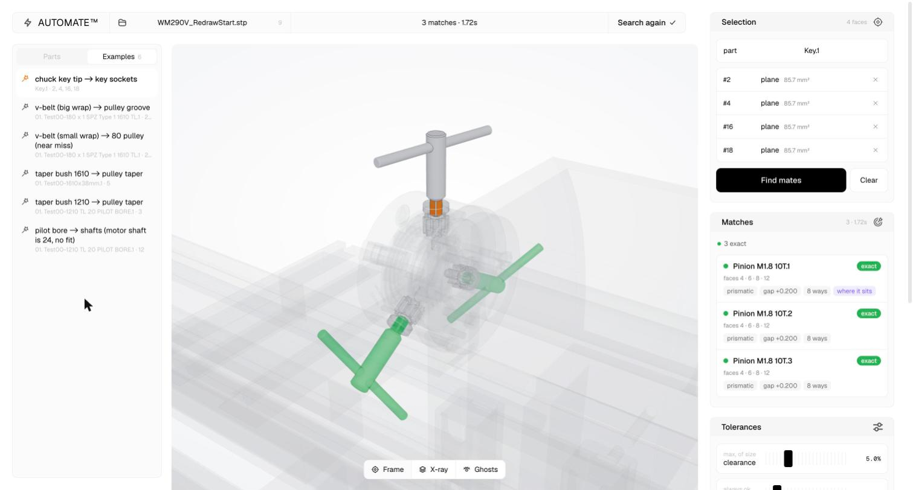
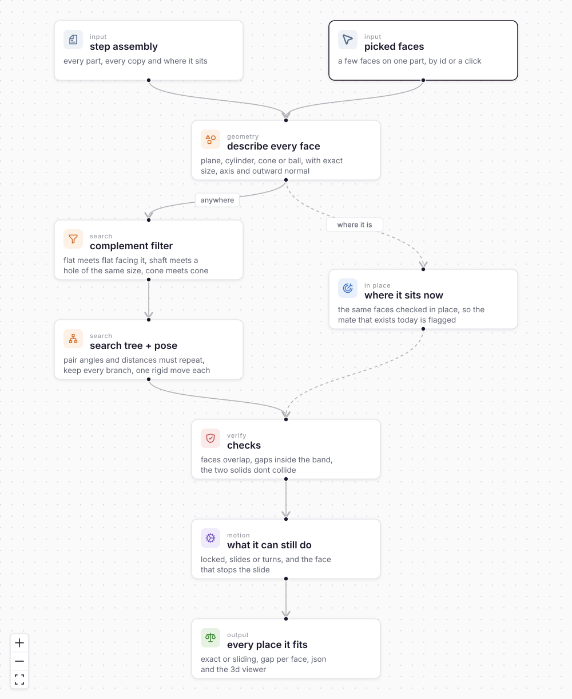

# automate

pick a few faces on one part of a STEP assembly. this finds every other place in the assembly where
those faces fit, which part each one is on, and whether its an exact fit or a sliding one.



## how it works



1. every face in the file becomes a plane, cylinder, cone or ball with its exact size and direction
2. only faces that could touch stay in: flat against flat, shaft in a hole of the same size, cone in cone
3. the picked faces are matched as a group. angles and distances between them have to show up again on the target
4. each match gets the move that puts the part there, then three checks: small enough gap, faces really overlap, solids dont crash
5. if the part can still slide or turn and nothing stops it, its sliding. if its held or something stops it (like the bottom of a socket), its exact

more detail, what breaks and what id do next: [WRITEUP.md](WRITEUP.md). every test case: [results/](results/README.md).

## why this way

- **finds every place**, not just the best one. the chuck key gets all 3 sockets, a screw all 8 holes
- **matches the group**, so one flat face doesnt match every flat face in the machine
- **exact sizes** from the file, so a 0.2 mm gap or a 4 degree difference shows up
- **easy to check**. every match lists which face landed where and the gap on each
- **no training data**. works on any STEP file, at any angle

## run it

the lathe from the assignment (`WM290V_RedrawStart.stp`) is in the repo root.

```sh
python3.13 -m venv .venv
.venv/bin/pip install cadquery-ocp-novtk numpy pytest
```

**command line**

```sh
.venv/bin/python -m automate match WM290V_RedrawStart.stp --part Key --faces 2,4,16,18
```

```
  Key  faces 2 4 16 18  (4 flat)
  gap allowed -0.10 to 0.39 mm, took 14.3 s

  3 places it fits

      fits on                        fit     moves    gap
  1   Pinion M1.8 10T.1 [4 6 8 12]   exact   slides   +0.20 mm   8 ways   already here
  2   Pinion M1.8 10T.2 [4 6 8 12]   exact   slides   +0.20 mm   8 ways
  3   Pinion M1.8 10T.3 [4 6 8 12]   exact   slides   +0.20 mm   8 ways

  touching now   Pinion M1.8 10T.1 [4 6 8 12]
```

`8 ways` is how many ways a square key drops into a square socket. `already here` is where it sits now.
add `--out key.json` for the full detail. `python -m automate faces <file> "<part>"` lists a part's faces.

**viewer**

```sh
.venv/bin/python -m automate serve WM290V_RedrawStart.stp fixtures/*.step
# open http://127.0.0.1:8765
```

click faces, press find mates. green is exact, blue is sliding. every tolerance is a slider and the
search reruns when you let go.

**tests**

```sh
scripts/fetch_external.sh        # downloads the bench vice
.venv/bin/python -m pytest -q    # 17 tests
```
