# results

generated by `python scripts/run_all.py`. each folder has the full `matches.json`.

| case | selection | what it tests | matches | result | s |
|---|---|---|---|---|---|
| lathe-chuck-key | Key #2,4,16,18 | chuck key square tip into the pinion sockets | 3 | Pinion M1.8 10T.1 [4, 6, 8, 12] exact/prismatic gap 0.200 (in place); Pinion M1.8 10T.2 [4, 6, 8, 12] exact/prismatic gap 0.200; Pinion M1.8 10T.3 [4, 6, 8, 12] exact/prismatic gap 0.200 | 13.2 |
| lathe-belt-big-pulley | 01. Test00-180 x 1 SPZ Type 1 1610 TL #27,23,31 | v-belt inner faces (big wrap) into the 180 pulley groove | 1 | 01. Test00-180 x 1 SPZ Type 1 1610 TL.1 [9, 10, 12, 13, 16, 17] exact/revolute gap 0.000 (in place) | 11.5 |
| lathe-belt-small-pulley | 01. Test00-180 x 1 SPZ Type 1 1610 TL #29,25,33 | v-belt small wrap vs 80 pulley: flank angle 71 vs 73, near miss | 0 | no match (touching now, partial: no contact on [[25], [33]]) | 11.4 |
| lathe-taper-bush-1610 | 1610x38mm #5 | taper bush outer cone into its pulley | 1 | 01. Test00-180 x 1 SPZ Type 1 1610 TL.1 [1, 3] exact/revolute gap -0.000 (in place) | 11.6 |
| lathe-taper-bush-1210 | 1210 TL Ø20 PILOT BORE #3 | taper bush outer cone into its pulley | 1 | 01. Test00-03-80 x 1 SPZ Type 1 1210 TL.1 [1, 3] exact/revolute gap -0.000 (in place) | 12.1 |
| lathe-pilot-bore | 1210 TL Ø20 PILOT BORE #12 | 20 mm pilot bore: the 24 mm motor shaft must not match | 2 | LeadScrew-20mm.1 [1, 2] sliding/cylindrical gap 0.000; 01. Test00-M90S B34(ok).1 [976, 978] sliding/cylindrical gap 0.000 | 17.1 |
| bench-vice-jaw | Vice Jaw #3,27,4,6 | real CATIA bench vice: jaw sliding on the base | 1 | Base.1 [5, 11, 17, 26] sliding/prismatic gap 0.000 (in place) | 0.9 |
| fixture-chuck_4slot-chuck_key | chuck_key #1,2,3,4 | 4 radial sockets; round hole, 12x12 pocket and 10x13 pocket are decoys | 4 | chuck_body.1 [2, 4, 5, 7] exact/prismatic gap 0.000; chuck_body.1 [8, 9, 10, 11] exact/prismatic gap 0.000; chuck_body.1 [12, 13, 14, 15] exact/prismatic gap 0.000; chuck_body.1 [16, 17, 18, 19] exact/prismatic gap 0.000 | 0.6 |
| fixture-keyed_shaft-key | key #1,2,3 | key flipped also fits the through keyway of both hubs (sliding, no stop); shaft keyway is blind (exact) | 3 | shaft.1 [4, 6, 8] exact/prismatic gap 0.000 (in place); hub.1 [5, 6, 7] sliding/prismatic gap 0.000; hub.2 [5, 6, 7] sliding/prismatic gap 0.000 | 0.1 |
| fixture-keyed_shaft-hub | hub #4,8 | a bore alone is a 2 dof cylindrical fit, any 20 mm shaft would do | 1 | shaft.1 [1] sliding/cylindrical gap 0.000 (in place) | 0.1 |
| fixture-vice_dovetail-sliding_jaw | sliding_jaw #4,5,6,7,8 | jaw groove 0.2 mm clear of the rail on flanks and top, base sits on the body | 1 | vice_body.1 [3, 5, 9, 10, 11] sliding/prismatic gap 0.204 (in place) | 0.1 |
| fixture-pin_plate-shoulder_pin | shoulder_pin #3,4 | shank + shoulder underside; 0.1 radial clearance so it is a running fit. 6 holes x either side of the plate = 12. the 10 mm centre hole is a decoy | 12 | plate.1 [3, 7] sliding/revolute gap 0.100; plate.1 [3, 8] sliding/revolute gap 0.100; plate.1 [3, 10] sliding/revolute gap 0.100; plate.1 [3, 11] sliding/revolute gap 0.100; plate.1 [3, 12] sliding/revolute gap 0.100; plate.1 [3, 13] sliding/revolute gap 0.100; plate.1 [5, 7] sliding/revolute gap 0.100; plate.1 [5, 8] sliding/revolute gap 0.100; plate.1 [5, 10] sliding/revolute gap 0.100; plate.1 [5, 11] sliding/revolute gap 0.100; plate.1 [5, 12] sliding/revolute gap 0.100; plate.1 [5, 13] sliding/revolute gap 0.100 | 0.1 |
| fixture-ball_socket-ball_stud | ball_stud #1 | two 20.2 sockets match, the 24 mm one is too loose | 2 | socket_block.1 [7] sliding/spherical gap 0.100; socket_block.1 [8] sliding/spherical gap 0.100 | 0.6 |

## screenshots

orange = selected faces, green = exact fit, blue = sliding fit, translucent copies = where the selected part would sit at each match.

### lathe-chuck-key

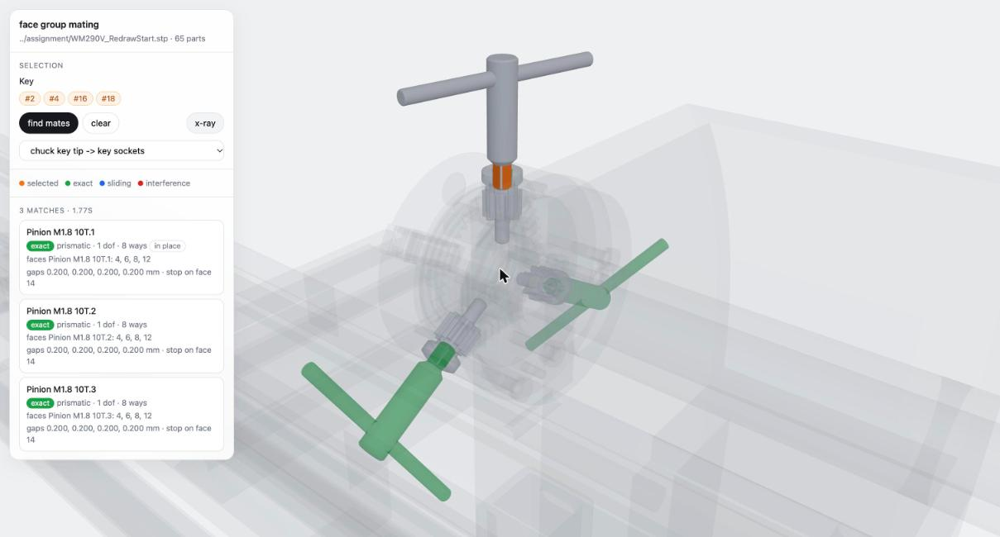

### lathe-belt-big-pulley

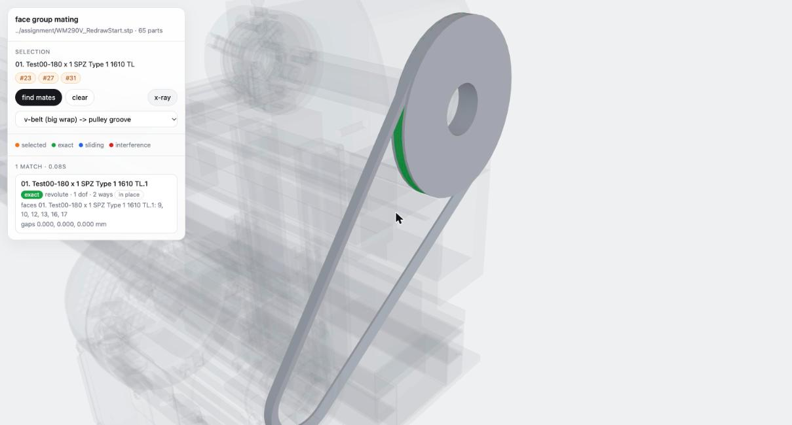

### lathe-belt-small-pulley

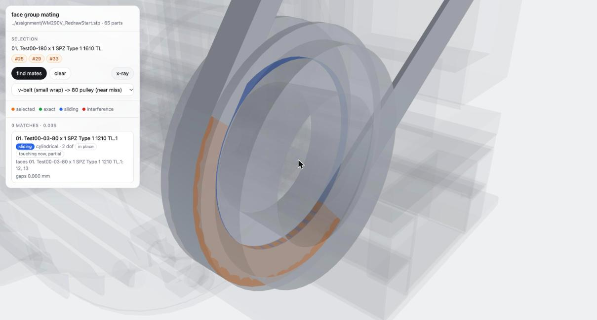

### lathe-taper-bush-1610

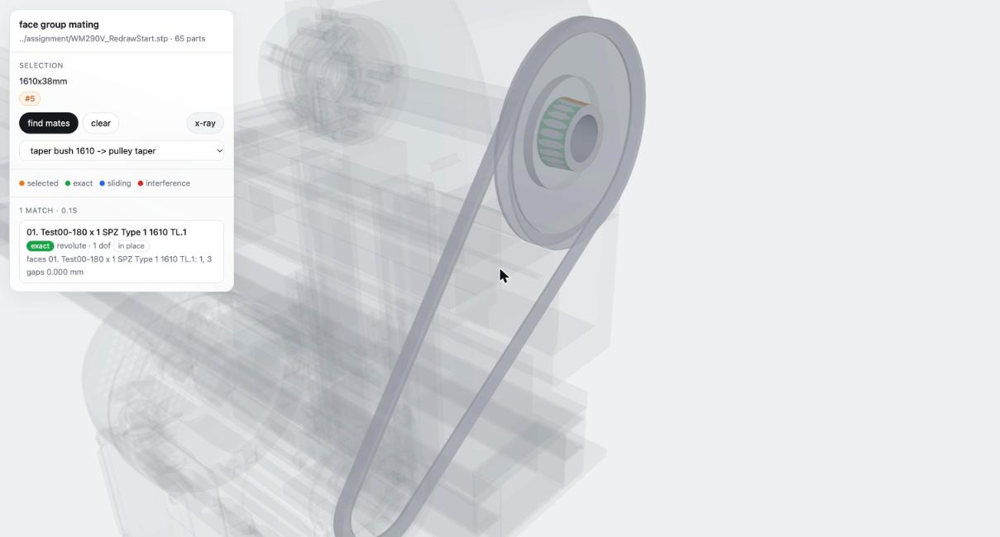

### lathe-taper-bush-1210

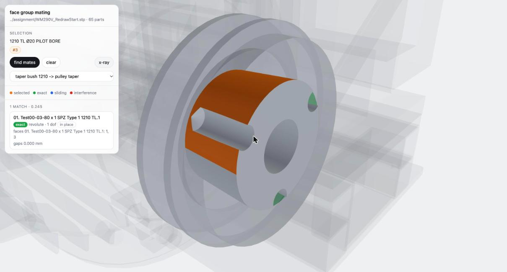

### lathe-pilot-bore

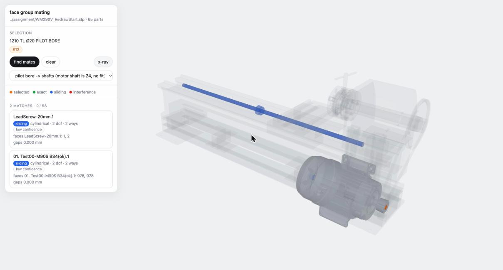

### bench-vice-jaw

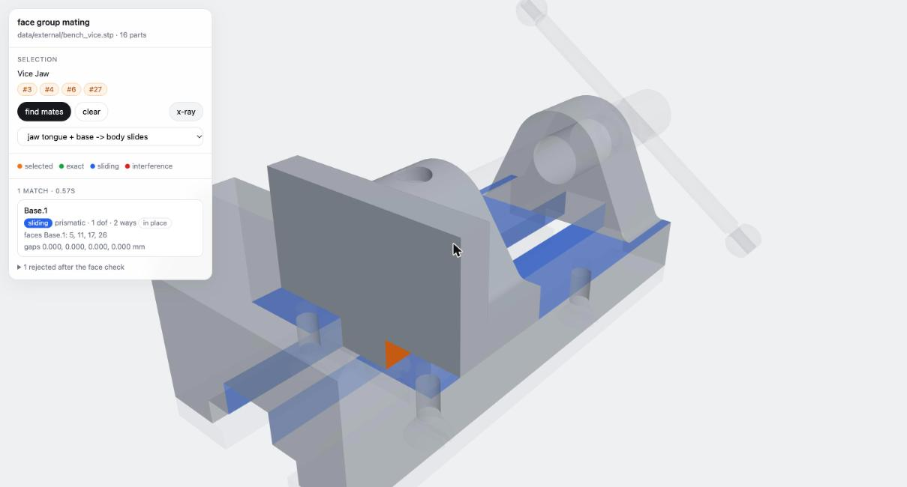

### fixture-chuck_4slot-chuck_key

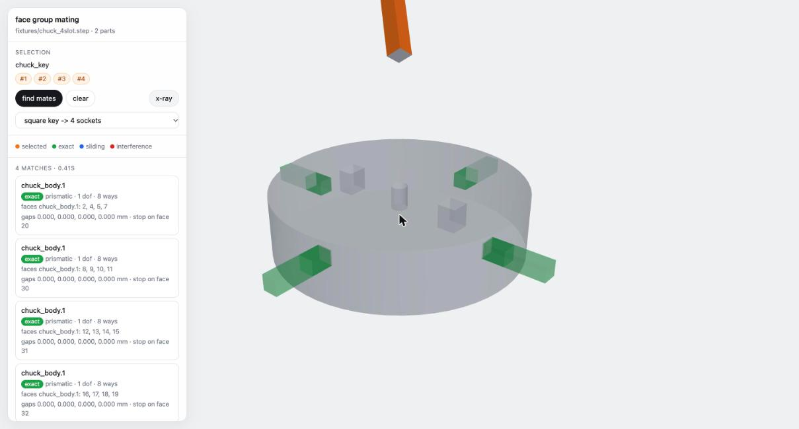

### fixture-keyed_shaft-key

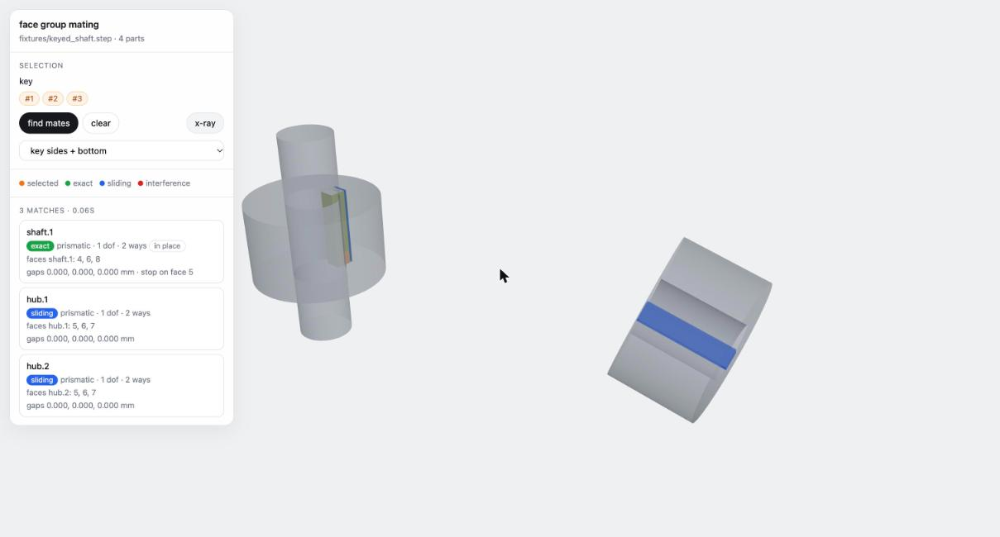

### fixture-keyed_shaft-hub

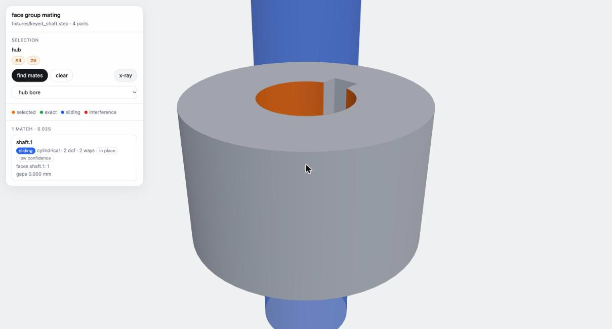

### fixture-vice_dovetail-sliding_jaw

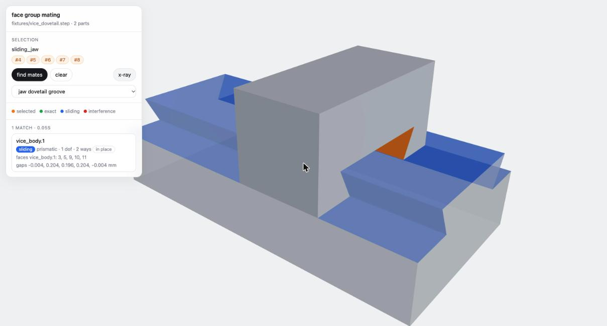

### fixture-pin_plate-shoulder_pin

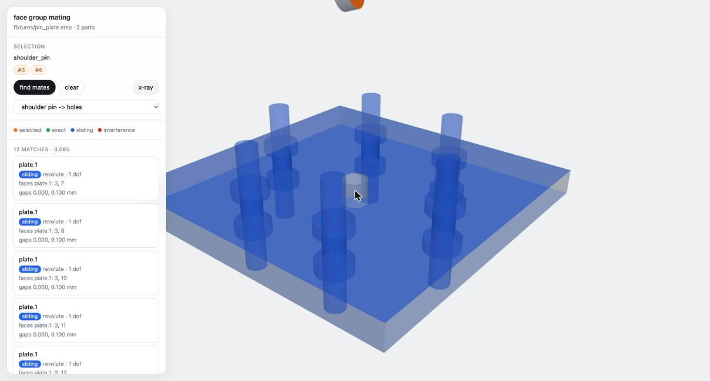

### fixture-ball_socket-ball_stud

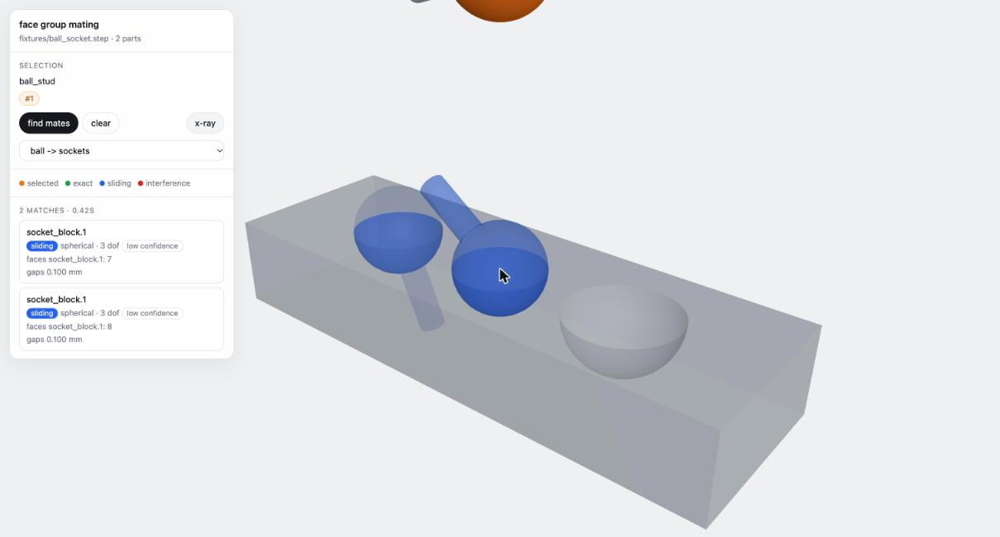

